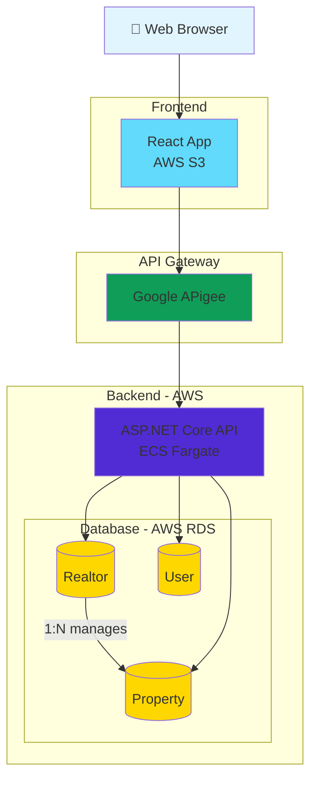
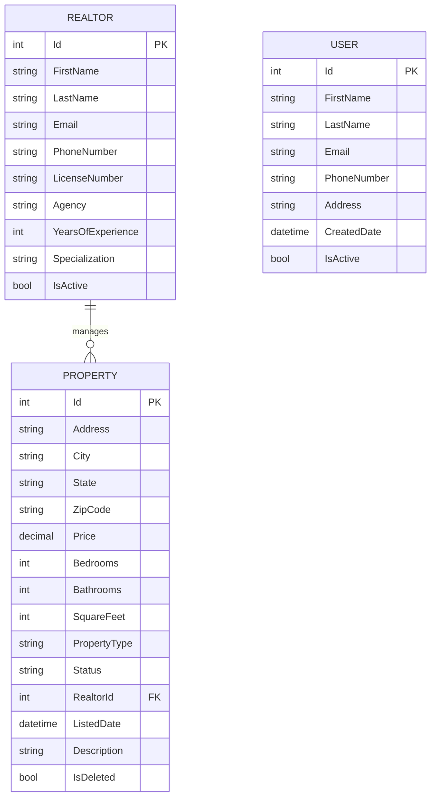
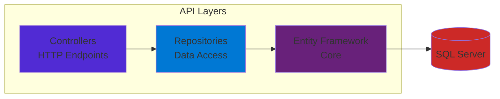

# Real Estate Data API & Web Application
## Full-Stack Cloud-Native MVP

---

## 📋 Project Overview

**Purpose**: Academic full-stack development project demonstrating cloud deployment skills

**Tech Stack**:
- Backend: ASP.NET Core 8.0 (C#)
- Frontend: React 19 + TypeScript + Vite
- Database: SQL Server (AWS RDS)
- Cloud: AWS (ECS Fargate, S3, RDS)
- API Gateway: Google APigee

---

## 🎯 Core Features

### Three Main Entities
1. **Properties** - Real estate listings with pricing, location, and features
2. **Realtors** - Licensed agents managing property listings
3. **Users** - End users with contact information and account status

### Functionality
- Complete CRUD operations for all entities
- RESTful API with Swagger/OpenAPI documentation
- Repository pattern for clean data access
- DTO-based API contracts with AutoMapper
- React web client for data visualization

---

## 🏗️ System Architecture



---

## 📊 Data Model



**Relationship**: One Realtor manages many Properties (1:N)

---

## 🔧 Backend Architecture

### Three-Layer Pattern



**Key Components**:
- **Controllers**: PropertyController, RealtorController, UserController
- **Repositories**: Generic `IRepository<T>` pattern for CRUD operations
- **Entity Framework Core**: ORM for database access
- **AutoMapper**: DTO ↔ Entity mapping
- **Global Error Handling**: Centralized exception middleware

---

## 🎨 Frontend Architecture

### React Application Structure

**Technology**:
- React 19.2.0 with TypeScript
- Vite 7.2.2 for fast builds
- Axios for API communication
- React Router for navigation

**Key Features**:
- Component-based architecture
- Type-safe API calls
- Responsive design
- Environment-based configuration

**API Integration**:
```typescript
// Centralized API service
VITE_API_BASE_URL → APigee Gateway → Backend API
```

---

## ☁️ Cloud Infrastructure

### AWS Services

| Service | Purpose |
|---------|---------|
| **AWS S3** | Static website hosting for React app |
| **AWS ECR** | Docker container registry |
| **AWS ECS Fargate** | Serverless container hosting for API |
| **AWS RDS** | Managed SQL Server database |
| **AWS IAM** | Access management and security |

### API Gateway
- **Google APigee**: API management, security, rate limiting, and monitoring

---

## 🔐 API Endpoints

### Properties
- `GET /api/properties` - List all properties
- `GET /api/properties/{id}` - Get property by ID
- `POST /api/properties` - Create new property
- `PUT /api/properties/{id}` - Update property
- `PATCH /api/properties/{id}` - Partial update
- `DELETE /api/properties/{id}` - Delete property

### Realtors
- `GET /api/realtors` - List all realtors
- `GET /api/realtors/{id}` - Get realtor by ID
- `POST /api/realtors` - Create new realtor
- `PUT /api/realtors/{id}` - Update realtor
- `PATCH /api/realtors/{id}` - Partial update
- `DELETE /api/realtors/{id}` - Delete realtor

### Users
- Similar CRUD operations for User entity

---

## 🚀 Deployment Pipeline

```mermaid
graph LR
    Code[Source Code] --> Build[Docker Build]
    Build --> ECR[Push to ECR]
    ECR --> ECS[Deploy to ECS]
    ECS --> Live[Live API]
    
    React[React Build] --> S3[Deploy to S3]
    S3 --> Web[Live Website]
    
    style Code fill:#333
    style Build fill:#2496ed
    style ECR fill:#ff9900
    style ECS fill:#ff9900
    style Live fill:#28a745
    style React fill:#61dafb
    style S3 fill:#ff9900
    style Web fill:#28a745
```



**Backend**: Code → Docker → ECR → ECS Fargate → Production

**Frontend**: React Build → S3 → Static Website

---

## 📈 Key Achievements

✅ **Full-Stack Development**
- Complete backend API with RESTful design
- Modern React frontend with TypeScript

✅ **Cloud Deployment**
- Containerized API on AWS ECS Fargate
- Static hosting on AWS S3
- Managed database on AWS RDS

✅ **Best Practices**
- Repository pattern for data access
- DTO pattern for API contracts
- Swagger/OpenAPI documentation
- Global error handling
- Environment-based configuration

✅ **API Gateway Integration**
- Security and rate limiting via APigee
- Centralized API management

---

## 🛠️ Development Tools

### Backend
- Visual Studio / VS Code
- .NET CLI
- Entity Framework CLI
- Docker Desktop
- SQL Server Management Studio

### Frontend
- VS Code
- npm/Node.js
- Vite dev server
- React DevTools

### Cloud & DevOps
- AWS CLI
- Docker
- PowerShell scripts for deployment

---

## 📚 Documentation

**Available Documentation**:
- API Documentation (Swagger UI)
- README files for setup instructions
- Deployment guides
- Troubleshooting guides
- Entity relationship diagrams
- Architecture diagrams

**API Testing**:
- Swagger UI for interactive testing
- Postman collections available
- Automated test scripts

---

## 🎓 Learning Outcomes

### Technical Skills Demonstrated
1. **Backend Development**: ASP.NET Core, Entity Framework, RESTful APIs
2. **Frontend Development**: React, TypeScript, modern JavaScript
3. **Database Design**: Relational modeling, migrations, SQL Server
4. **Cloud Computing**: AWS services, containerization, serverless
5. **DevOps**: Docker, CI/CD concepts, deployment automation
6. **API Management**: APigee gateway integration
7. **Software Architecture**: Layered architecture, design patterns

---

## 🔮 Future Enhancements

**Potential Improvements**:
- User authentication and authorization (JWT)
- Image upload for properties
- Advanced search and filtering
- Favorites and saved searches
- Email notifications
- Real-time updates with SignalR
- Mobile app (React Native)
- Analytics dashboard
- Integration with mapping services

---

## 🙏 Thank You

### Questions?

**Project Repository**: [GitHub Link]

**Live Demo**:
- Frontend: [S3 Website URL]
- API: [APigee Gateway URL]
- API Docs: [Swagger URL]

**Team Members**: [Your Team Names]

---

## 📞 Contact Information

**Project Team**:
- [Team Member 1] - [Role] - [Email]
- [Team Member 2] - [Role] - [Email]
- [Team Member 3] - [Role] - [Email]

**Academic Supervisor**: [Supervisor Name]

**Course**: [Course Name/Code]

**Institution**: [University Name]

**Date**: November 2025
